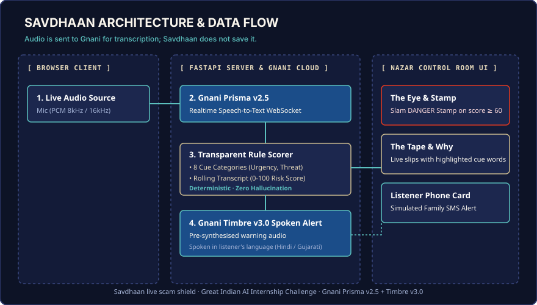

# Savdhaan (सावधान) · Live Scam-Call Shield

Savdhaan protects citizens from scam calls in real time using explainable speech intelligence.
It listens to incoming phone conversations via browser microphone (e.g. a call on speakerphone), scores rolling bilingual transcripts with deterministic rules,
and speaks immediate warnings while simulating family alerts before money or credentials are lost.

Built for the **Great Indian AI Internship Challenge** by **Gnani AI** (Deadline: Nov 10, 2026, 11:59 PM IST).



## Run in Two Minutes (Offline Demo)

Zero configuration, zero API credits, and no secrets needed:

```bash
python -m venv .venv
# On Windows: .venv\Scripts\activate | On Linux/macOS: source .venv/bin/activate
pip install -r requirements.txt
python scripts/demo.py
```
Open [http://localhost:8000](http://localhost:8000). Click **Play a sample scam call** to watch real-time detection.

## Live Mode with Gnani AI

```bash
cp .env.example .env
# Edit .env and set your GNANI_API_KEY
python -m backend.main
```

## Where Gnani AI Is Used

| Capability | Gnani Engine | Endpoint | Calling Code |
| :--- | :--- | :--- | :--- |
| Live Speech Recognition | **Gnani Prisma v2.5** | `wss://api.vachana.ai/stt/v3/stream` | `backend/gnani_stream.py` |
| Benchmark Speech Recognition | **Gnani Prisma v2.5** (REST) | `https://api.vachana.ai/stt/v3` | `backend/gnani_stt.py` |
| Voice Warning Generation | **Gnani Timbre v3.0** | `https://api.vachana.ai/api/v1/tts/inference` | `backend/gnani_tts.py` |

## Measured Evaluation (Khata Ledger)

All figures come directly from `data/eval/results.json` (`/report.html`):

<!-- RESULTS:START -->
| Evaluation Split | Mode | Scam Recall (95% CI) | False Alarm Rate (95% CI) | F1 Score |
| :--- | :--- | :--- | :--- | :--- |
| **Dev Split** (5 scam + 5 legit calls) | Perfect Transcript (Ceiling) | **100.0% (5 of 5)** `[0.5655, 1.0000]` | **0.0% (0 of 5)** `[0.0000, 0.4345]` | **1.0000** |
| **Dev Split** (5 scam + 5 legit calls) | Real Prisma (`phone_noise`) | not measured yet (`python scripts/run_eval.py record --split dev --go`) | - | - |
| **Test Split** (5 scam + 5 legit calls, frozen) | Perfect Transcript (Ceiling) | **80.0% (4 of 5)** `[0.3755, 0.9638]` | **0.0% (0 of 5)** `[0.0000, 0.4345]` | **0.8889** |
| **Test Split** (5 scam + 5 legit calls, frozen) | Real Prisma (`phone_noise`) | not measured yet (`python scripts/run_eval.py record --split test --go`) | - | - |
| **Blind Set** (written by someone else) | Perfect Transcript (Ceiling) | not measured yet (`python scripts/run_eval.py score --split blind --ceiling`) | - | - |
| **Blind Set** (written by someone else) | Real Prisma (`phone_noise`) | not measured yet (`python scripts/run_eval.py score --split blind --ceiling`) | - | - |
<!-- RESULTS:END -->

- **Limitations**: Synthetic TTS voices; small sample sizes (10 calls/split); frozen test split scored 1 time.
- Expected miss noted in test split: `T05_card_pin` (subtle conversational trap without threat keywords).

## Where Does My Audio Go?

When using **Listen live**, microphone audio is streamed securely from your browser over WebSocket to the local backend, and forwarded directly to **Gnani Prisma v2.5** cloud for live speech-to-text. No audio is ever written to disk or recorded unless `SAVE_LIVE_RUNS=true` is explicitly configured in your environment.

When using **Try your own words**, text sentences are evaluated 100% locally on the backend using deterministic rule matching without any network or Gnani API credit usage.

## Safety, Privacy & Honest Demo

- **100% Synthetic Data**: All test recordings, names, and numbers are artificial.
- **Zero Voice Cloning**: No voice imitation or speaker cloning APIs are ever called.
- **Privacy First**: Microphone audio is streamed directly to RAM buffers and never saved to disk.
- **Simulated Family Alerts**: All SMS and notification dispatches are strictly simulated.
- **Clear Demarcation**: UI displays `LIVE MIC`, `FILE`, `REPLAY`, or `DEMO · recorded` badges at all times.
- **Not a Helpline Replacement**: Intended as a personal safeguard, not a substitute for national cybercrime reporting (1930) or banking helplines.
- **Language Policy**: English is the primary language across all interfaces; see [LANGUAGE_RULE.md](docs/LANGUAGE_RULE.md).

## Submission

- **Challenge**: Great Indian AI Internship Challenge by Gnani AI
- **Tags**: #GnaniAI #GreatIndianAIInternshipChallenge

## License

MIT License. See [LICENSE](LICENSE) for details.
