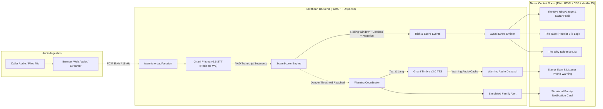
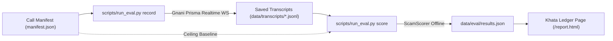

# Savdhaan Architecture

Savdhaan is a client-server live scam detection system that couples low-latency speech streaming with deterministic, explainable conversational reasoning.

## 1. Live Call Defense Pipeline

### Explanation of Live Flow
1. **Audio Ingestion**: Audio originates from a live microphone or audio file, is framed into standard 1024-byte PCM chunks, and forwarded over WebSocket to the FastAPI backend.
2. **Speech Recognition**: The backend proxies the PCM stream to Gnani Prisma v2.5 STT over a persistent WebSocket connection with Voice Activity Detection (VAD).
3. **Conversational Risk Scoring**: Each transcript segment is tokenized, normalized (stripping punctuation, normalising nukta and chandrabindu), and evaluated by `ScamScorer` using dual-language rule packs (Hindi, English, Gujarati). Evidence decays over a rolling window, combo rules add non-linear bonuses for dangerous category pairings, and negation guards suppress false positives.
4. **Protective Response**: When risk crosses the danger threshold (score ≥ 60), the backend triggers Gnani Timbre v3.0 TTS to speak a localized, calm intervention directly to the listener while an evil-eye rubber stamp slams onto the control tape and a simulated alert notifies trusted contacts.

---

## 2. Evaluation & Measurement Pipeline

### Explanation of Evaluation Flow
1. **One-Time Recording**: `scripts/run_eval.py record` streams synthetic call recordings from the manifest through Gnani Prisma once to create persistent, real-world transcript logs (`.jsonl`).
2. **Offline Scoring**: `scripts/run_eval.py score` executes entirely offline without spending credits, feeding transcript lines through `ScamScorer` to measure Recall, False Alarm Rates, Time-to-Alert, and Wilson Score 95% Confidence Intervals.
3. **Honest Ledger**: All computed metrics are written to `results.json` and consumed directly by the Khata report page (`/report.html`) without any manually typed statistics.
